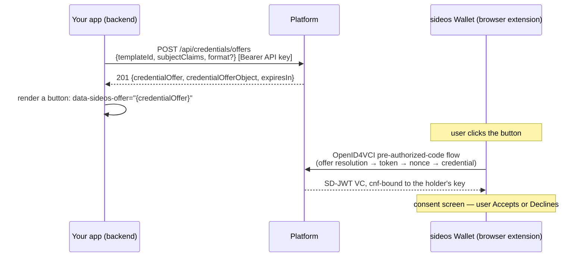
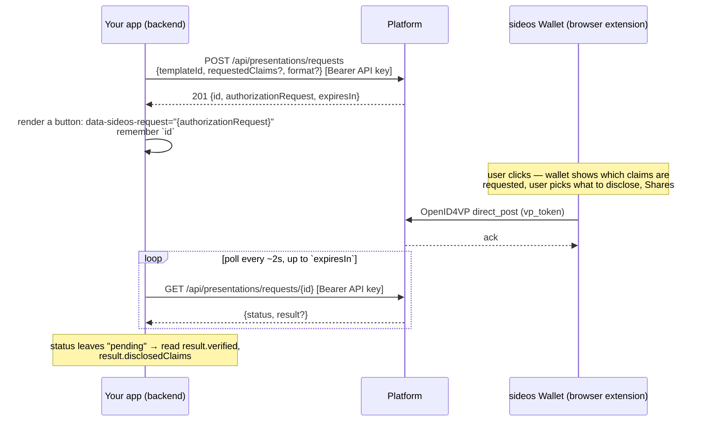

# Integrating with the sideos Wallet browser extension

A guide for issuer/verifier application developers: the full flow for
issuing a credential into this wallet and for requesting/verifying one
back, the exact platform endpoints involved, and — the part most likely
to get skipped — what comes back after verification and what your
application does with it.

**iPhone:** the VCu Wallet iOS app is reached through links, QR codes
and Safari's Digital Credentials API instead of `data-sideos-*`
attributes. See [the iOS app page](); the platform calls below are the same.

**Scope check:** this covers the `dc+sd-jwt` format end to end (the
worked examples below). The platform and this wallet both also support
`mso_mdoc` via the same two endpoints (`format: 'mso_mdoc'`) — noted
inline where the shape actually differs, but not separately walked
through.

## Prerequisites (one-time, not covered here)

You need an org, a credential template, and an API key scoped `issue`
and/or `verify` before any of this works. That setup is done in the
platform's console (authenticated as a console user, not with the API key
itself) and isn't covered here; it comes from whoever runs your platform
instance. Keep the API key **server-side only** — every endpoint below is called
with `Authorization: Bearer <api-key>`, and that key must never reach a
browser.

---

## Flow 1: issuing a credential



1. Your backend calls `POST /api/credentials/offers` with the claims for
   *this specific* credential.
2. Your frontend renders a button/link carrying the returned
   `credentialOffer` URI as a `data-sideos-offer` attribute (see
   "Wiring up the trigger" below).
3. The user clicks it. Everything from here — resolving the offer,
   redeeming the pre-authorized code, proving key possession, receiving
   the credential — happens directly between the wallet and the
   platform. **Your app is not in that path and gets no callback.**
4. There is no signal back to your app for accept vs. decline. If you
   need to know whether the user actually has the credential, that has
   to come from a later presentation request (flow 2) — issuance itself
   is fire-and-forget, the same way any "add to wallet" button is.

### `POST /api/credentials/offers`

Scope required: `issue`.

```jsonc
// Request
{
  "templateId": "231e6581-…",              // required, uuid — from your own template setup
  "subjectClaims": { "employer": "Sideos", "employeeName": "Ada Lovelace" }, // required, non-empty, your business data
  "format": "dc+sd-jwt"                    // optional, defaults to "dc+sd-jwt"; "mso_mdoc" also accepted
}
```

```jsonc
// 201 Response
{
  "credentialOffer": "openid-credential-offer://?credential_offer=%7B...%7D", // hand this to the wallet trigger
  "credentialOfferObject": { /* the decoded offer, if you want to inspect it */ },
  "expiresIn": 600                          // seconds — single-use, expires either way
}
```

Worth knowing:
- **`subjectClaims` is not validated against the template's
  `claimsSchema`.** The schema is documentation, not an enforced
  contract — whatever object you send is exactly what gets issued.
  Validate on your own side if that matters to you.
- `format` must also be listed in the template's own `formats` array, or
  you get `400 this template does not permit format {format}`.
- `404 template not found` also covers a template that exists but
  belongs to a different org than your API key's.

---

## Flow 2: requesting and verifying a presentation



1. Your backend calls `POST /api/presentations/requests`, naming which
   claims you want (or omit `requestedClaims` and let the wallet decide
   what's disclosable).
2. Your frontend renders a button carrying the returned
   `authorizationRequest` URI as `data-sideos-request`, and **holds onto
   the `id`** — that's your poll key.
3. The user clicks, reviews which claims are being asked for in the
   wallet's own UI, and shares (or declines — see "Errors and edge
   cases").
4. **Your app polls `GET /api/presentations/requests/{id}` until
   `status` is no longer `"pending"`.** This is the step the previous
   version of this guide skipped — it's not optional, it's how you find
   out anything happened at all.

### `POST /api/presentations/requests`

Scope required: `verify`.

```jsonc
// Request
{
  "templateId": "231e6581-…",               // required, uuid
  "requestedClaims": ["employer"],          // optional — omit and the wallet decides what to disclose
  "format": "dc+sd-jwt"                     // optional, defaults to "dc+sd-jwt"
}
```

```jsonc
// 201 Response
{
  "id": "d93044af-…",                        // your poll key — save this
  "authorizationRequest": "openid4vp://?response_type=vp_token&…", // hand this to the wallet trigger
  "expiresIn": 600
}
```

For `mso_mdoc`, each name in `requestedClaims` becomes a
`[docType, name]` DCQL path instead of `[name]` — the namespace is
always the template name. You don't need to do anything differently to
request it; just set `format`.

### `GET /api/presentations/requests/{id}` — the verification result

This is the one your integration actually depends on. `status` is
`"pending" | "verified" | "failed"`.

**While pending** — `result` isn't present at all (not `null`, absent):

```json
{ "id": "d93044af-…", "status": "pending", "vct": "EmploymentBadge", "templateId": "231e6581-…" }
```

**Verified** — `status` flips to `"verified"` exactly when
`result.verified` is `true`:

```json
{
  "id": "d93044af-…",
  "status": "verified",
  "vct": "EmploymentBadge",
  "templateId": "231e6581-…",
  "result": {
    "verified": true,
    "disclosedClaims": { "employer": "Sideos" },
    "issuerId": "did:jwk:eyJjcnYi…",
    "errors": []
  }
}
```

- **`disclosedClaims`** is exactly what the user chose to disclose in
  the wallet — this is the actual payload your application acts on
  (e.g. "employer confirmed: Sideos"). Never assume every claim you
  requested is present; the user can decline optional ones.
- **`issuerId`** is the issuer's `did:jwk` for `dc+sd-jwt`. **For
  `mso_mdoc` it's the docType (= the issuer's template name), not a
  DID** — don't treat it as a DID unconditionally if you support both
  formats.
- `errors` is present as `[]` on success, not omitted.
- Both `disclosedClaims` and `issuerId` are technically optional even
  when `verified: true` — check for their presence rather than assuming.

**Failed** — `status` is `"failed"` whenever `result.verified` is
`false`:

```json
{
  "id": "d93044af-…",
  "status": "failed",
  "vct": "EmploymentBadge",
  "templateId": "231e6581-…",
  "result": {
    "verified": false,
    "errors": [{ "code": "signature_invalid", "message": "nonce mismatch" }]
  }
}
```

`disclosedClaims` and `issuerId` are absent on every failure path.
`errors[].code` is one of `signature_invalid | issuer_unresolvable |
expired | not_yet_valid | revoked | status_unavailable | malformed` —
there can be more than one entry (e.g. several binding checks failing at
once).

---

## Errors and edge cases

- **Expiry.** Both offers and presentation requests live 600 seconds and
  are single-use. After that, `GET` on a presentation request returns
  `404 presentation request not found or expired` — indistinguishable
  from a typo'd id. Stop polling once you hit `expiresIn`, don't wait
  for a `failed` that will never come.
- **Decline is silent.** If the user declines (or never responds), the
  session just sits `pending` until it expires, then 404s. There's no
  explicit "declined" status — your app has to treat "still pending at
  expiry" as the decline/timeout case.
- **A completed session can't be replayed.** A second attempt to
  complete the same presentation returns `400 this presentation request
  has already been completed` — but that's the *wallet's* error, not
  something your polling `GET` ever surfaces; your `GET` just keeps
  returning the original result.
- **Unknown `id`** (never created, or from a different org's API key) is
  a `404`, same as expired — you can't tell the two apart from the
  response alone.

---

## Wiring up the trigger

Once you have `credentialOffer` or `authorizationRequest` from the calls
above, hand it to the wallet with one of two data attributes — this is
this wallet's own convention, not a web standard, since a browser
extension can't register as an OS-level handler for
`openid-credential-offer://` / `openid4vp://` the way a native app could:

| Attribute | Value |
|---|---|
| `data-sideos-offer` | the `credentialOffer` URI, verbatim |
| `data-sideos-request` | the `authorizationRequest` URI, verbatim |

```html
<button id="add-to-wallet">Add to wallet</button>
<script>
  document.getElementById('add-to-wallet')
    .setAttribute('data-sideos-offer', credentialOfferFromYourBackend);
</script>
```

Put it on any clickable element — button, link, div. If it's an `<a>`,
the wallet's content script calls `preventDefault()` for you so the
browser doesn't try (and fail) to navigate to the unsupported scheme.

After the click: the wallet stores the URI as its one pending action and
tries to open its own popup automatically; if that's not possible in a
given browser state, its toolbar icon changes to a badge instead, and
the user can open it manually. Either way, **your page's job ends at the
click** — the consent/share screen is entirely the wallet's own UI.

---

## Alternative: the W3C Digital Credentials API

Instead of a `data-sideos-request` trigger, a verifier page can ask for a
presentation the standard way, with no wallet-specific attribute:

1. **Create the request** with `dcApiOrigin` set to your page's exact
   origin:
   `POST /api/presentations/requests` with
   `{ "templateId": "…", "dcApiOrigin": "https://shop.example.com" }`.
   The response carries `digitalCredentialRequest` (`{ protocol, data }`)
   instead of `authorizationRequest`.
2. **Call the browser API** from a click handler:

   ```js
   const credential = await navigator.credentials.get({
     mediation: 'required',
     digital: { requests: [digitalCredentialRequest] },
   });
   ```

3. **Forward the answer** from your backend: POST `credential.data` to
   `POST /api/presentations/requests/{id}/response`. The reply is the final
   status, so there's no polling. The wallet encrypts the answer to the
   request's key, so your page only ever holds a JWE.

What changes compared to the trigger flow:

- **Decline isn't silent.** If the user denies, the promise rejects with a
  `NotAllowedError`. If the popup is closed without a decision, it rejects
  with an `AbortError` after 10 minutes.
- **The presentation is bound to your page's origin**, which the browser
  reports. It is not the request's `client_id`, and a mismatch fails
  verification.
- **Which wallet answers is the browser's choice.** With this extension
  installed it answers OpenID4VP calls itself; without it, Chrome shows its
  own picker, which on a desktop is a QR code for a phone. The extension
  sets `window.__sideosWalletDcApi = true` in the page if you want to label
  that.

---

## Full example

[example.html]({{ '/integration/example.html' | relative_url }}) shows the
client-side trigger mechanics — paste a URI, click, watch the wallet react.
It is served over `https://` from this site, which is what the wallet needs:
the content script isn't injected into `file://` pages.

That file deliberately stops at the trigger, since it has no real
backend behind it. Putting the whole thing together, end to end:

```js
// --- your backend -----------------------------------------------------

// Issuance
async function createOffer(subjectClaims) {
  const res = await fetch(`${PLATFORM_URL}/api/credentials/offers`, {
    method: 'POST',
    headers: { Authorization: `Bearer ${API_KEY}`, 'Content-Type': 'application/json' },
    body: JSON.stringify({ templateId: TEMPLATE_ID, subjectClaims }),
  });
  const { credentialOffer } = await res.json();
  return credentialOffer; // send this to your frontend
}

// Verification: create the request
async function createPresentationRequest(requestedClaims) {
  const res = await fetch(`${PLATFORM_URL}/api/presentations/requests`, {
    method: 'POST',
    headers: { Authorization: `Bearer ${API_KEY}`, 'Content-Type': 'application/json' },
    body: JSON.stringify({ templateId: TEMPLATE_ID, requestedClaims }),
  });
  return res.json(); // { id, authorizationRequest, expiresIn } — send both to your frontend
}

// Verification: your frontend polls THIS endpoint, which proxies the platform
// (keeps the API key server-side — never expose it to the browser)
async function getPresentationStatus(id) {
  const res = await fetch(`${PLATFORM_URL}/api/presentations/requests/${id}`, {
    headers: { Authorization: `Bearer ${API_KEY}` },
  });
  if (res.status === 404) return { status: 'expired' };
  return res.json();
}

// --- your frontend -------------------------------------------------------

async function onVerifyClick() {
  const { id, authorizationRequest, expiresIn } = await fetch('/your-backend/create-request').then((r) => r.json());
  document.getElementById('share-button').setAttribute('data-sideos-request', authorizationRequest);

  const deadline = Date.now() + expiresIn * 1000;
  const poll = setInterval(async () => {
    if (Date.now() > deadline) return clearInterval(poll);
    const status = await fetch(`/your-backend/presentation-status/${id}`).then((r) => r.json());
    if (status.status === 'pending') return;
    clearInterval(poll);
    if (status.status === 'verified') {
      console.log('disclosed:', status.result.disclosedClaims);
      // act on it — e.g. show "employer confirmed: " + status.result.disclosedClaims.employer
    } else {
      // status.status === 'failed' or 'expired' — treat as "didn't verify," show accordingly
    }
  }, 2000);
}
```

## Current limitations

- **`http://`/`https://` pages only** — the content script isn't
  injected into `file://` pages.
- **No wallet-presence signal for the trigger flow.** For
  `data-sideos-*` buttons, your page can't detect whether the extension is
  installed. The DC API path above does have one:
  `window.__sideosWalletDcApi`.
- **One pending action at a time.** Triggering a second offer/request
  before the wallet handles the first replaces it — no queue.
- **This wallet's own convention.** A different wallet extension won't
  react to `data-sideos-offer`/`data-sideos-request`.
